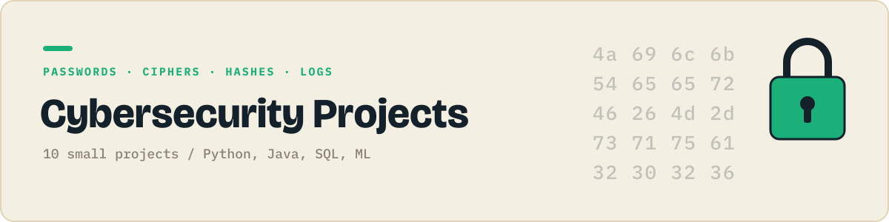

<p align="center"></p>

<p align="center">
  
  
</p>

Passwords, ciphers, hashes and logs, all safe and local.

Each folder is one small, self contained project that does one thing. They get harder as the numbers go up: first scripts, then data and charts, then Java, SQL and APIs, then a first machine learning model.

## Projects

| # | Project | What it does | Language | Status |
|:-:|---|---|:-:|:-:|
| 01 | Password strength checker | Rates a password as weak, okay or strong. |  | 🔜 |
| 02 | Caesar cipher | Encrypts and decrypts text by shifting letters. |  | ⬜ |
| 03 | Random password generator | Generates strong random passwords. |  | ⬜ |
| 04 | SHA-256 file integrity checker | Detects if a file has been changed. |  | ⬜ |
| 05 | Caesar cipher cracker | Breaks a Caesar cipher using letter frequency. |  | ⬜ |
| 06 | Vigenere cipher | Encrypts text with a keyword cipher. |  | ⬜ |
| 07 | Web server log parser | Finds the top IPs and 404 errors in a log. |  | ⬜ |
| 08 | Was my password leaked? | Checks a password against breaches without sending it. |  | ⬜ |
| 09 | SQL injection and the fix | Shows an injection on a local toy app, then fixes it. |  | ⬜ |
| 10 | SMS spam classifier | Flags spam texts with naive Bayes. |  | ⬜ |

✅ done &nbsp; 🔜 up next &nbsp; ⬜ planned

## Running a project

```bash
git clone https://github.com/JilkaTeerth/cybersecurity-projects.git
cd cybersecurity-projects/01-...
```

Every folder has its own README with the exact commands. Python projects need `pip install -r requirements.txt`, Java projects compile with plain `javac`.

---

<sub>Part of a series of six project collections. See them all at [github.com/JilkaTeerth](https://github.com/JilkaTeerth).</sub>
